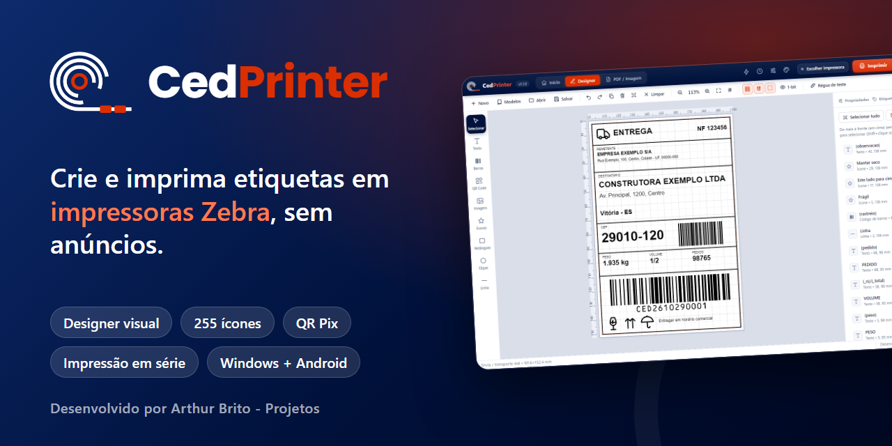

  🌐 <a href="README.md">Português</a> · <a href="README.en.md">English</a> · <a href="README.es.md">Español</a> · <a href="README.zh.md">中文</a> · <a href="README.hi.md">हिन्दी</a> · <a href="README.ar.md">العربية</a> · <b>Français</b> · <a href="README.bn.md">বাংলা</a> · <a href="README.ru.md">Русский</a> · <a href="README.ur.md">اردو</a> · <a href="README.id.md">Bahasa Indonesia</a> · <a href="README.de.md">Deutsch</a> · <a href="README.ja.md">日本語</a>

  

<h3 align="center">Créez et imprimez des étiquettes sur imprimantes Zebra, sans publicité.</h3>

  Designer visuel · impression en série · QR Pix · 255 icônes · modèles prêts à l'emploi · Windows et Android

  
  
  
  
  

  <a href="https://github.com/arthurbrito-pjt/CedPrinter-releases/releases/latest"><b>⬇️ Télécharger CedPrinter</b></a>

  

---

## De quoi s'agit-il ?

**CedPrinter** est une application pour **créer et imprimer des étiquettes sur imprimantes Zebra (ZPL)**, conçue pour **Cedisa Central de Aço** et ouverte à tous. Elle est gratuite, **sans publicité** et 100 % en portugais. Le code source est privé ; vous trouverez ici les installateurs et les versions publiées.

Elle compose l'étiquette à la **taille exacte de votre support** et l'envoie directement à l'imprimante : la taille et la position sont donc toujours justes.

## En images

<table>
  <tr>
    <td width="50%"> <b>Accueil :</b> raccourcis, modèles prêts à l'emploi et impressions récentes.</td>
    <td width="50%"> <b>Modèles prêts à l'emploi :</b> expédition, volume, date de validité, prix, Pix et bien plus.</td>
  </tr>
  <tr>
    <td> <b>255 icônes</b> avec recherche en portugais.</td>
    <td> <b>QR Code avec assistant :</b> Pix, Wi-Fi, lien, WhatsApp et contact.</td>
  </tr>
  <tr>
    <td> <b>Aperçu 1 bit :</b> voyez comment la Zebra va imprimer.</td>
    <td> <b>Thème clair et sombre</b> et couleur d'accentuation.</td>
  </tr>
</table>

## Points forts

- **Designer visuel :** texte, codes-barres (Code 128, Code 39, EAN-13/8, UPC-A, ITF), QR Code, Data Matrix, PDF417, images, icônes, formes et lignes.
- **Une vraie édition :** sélection multiple, alignement et répartition, repères, calques, copier/coller, annuler/rétablir.
- **Impression en série :** importez un tableur (Excel/CSV) et imprimez une étiquette par ligne, avec numéro de série.
- **Dates calculées :** `{_data+30}` pour la date de validité, avec plusieurs formats.
- **QR Code avec assistant :** Pix, Wi-Fi, lien, contact, WhatsApp, e-mail, SMS et carte. **Validation** des codes avant l'impression.
- **PDF et image :** impression en taille réelle, ou envoi vers le Designer pour modification.
- **Modèles prêts à l'emploi** et bibliothèque personnelle, historique et étiquette rapide.
- **Impression directe (ZPL) :** par réseau (IP), USB/Windows, Wi-Fi, Bluetooth et USB (Android).
- **Mise à jour automatique**, avec l'affichage des nouveautés.

## Télécharger

**➡️ [Ouvrir la dernière version](https://github.com/arthurbrito-pjt/CedPrinter-releases/releases/latest)** et télécharger le fichier dans la liste **Assets** :

| Fichier | Utilité |
|---|---|
| `CedPrinter-Setup-X.exe` | **Installateur Windows** (recommandé). Se met à jour tout seul. |
| `CedPrinter-PC-X.zip` | Version portable pour Windows, sans installation. Ne se met pas à jour toute seule. |
| `CedPrinter-X.apk` | **Application Android** (téléphone et terminal mobile). |

> `latest.yml` est un fichier interne de mise à jour : inutile de le télécharger.

## Installer

### 🖥️ Windows

1. Téléchargez `CedPrinter-Setup-X.exe` et ouvrez-le.
2. Si Windows affiche « Windows a protégé votre ordinateur », cliquez sur **Informations complémentaires → Exécuter quand même** (l'installateur n'a pas encore de signature de code).
3. Suivez l'assistant et cliquez sur **Installer**.
4. À la première utilisation, cliquez sur le bouton de l'imprimante, en haut de l'écran, et choisissez votre Zebra.

### 📱 Android

1. Téléchargez `CedPrinter-X.apk` sur l'appareil et ouvrez le fichier.
2. Si Android le demande, autorisez l'**installation d'applications inconnues** pour le navigateur ou le gestionnaire de fichiers utilisé.
3. Ouvrez CedPrinter, allez dans **Imprimantes** et choisissez la Zebra (Wi-Fi, Bluetooth ou USB).

## Foire aux questions

**Quelles imprimantes fonctionnent ?** Les imprimantes **Zebra compatibles ZPL** (référence : ZD230, 203 dpi), par réseau, USB ou Bluetooth. Les autres marques ne sont pas compatibles.

**Ai-je besoin d'Internet ?** Uniquement pour télécharger l'application et les mises à jour. L'impression et la création d'étiquettes fonctionnent hors ligne.

**L'application collecte-t-elle mes données ?** Non. Vos modèles, votre historique et vos réglages restent sur votre ordinateur. L'application consulte seulement GitHub pour savoir s'il existe une nouvelle version.

**Est-ce gratuit ?** Oui, pour un usage personnel comme commercial. Consultez les [conditions d'utilisation](LICENSE) (en portugais).

**J'ai trouvé un problème ou j'ai une idée.** Ouvrez une [issue](https://github.com/arthurbrito-pjt/CedPrinter-releases/issues/new/choose) en indiquant la version et, si possible, l'imprimante.

## Historique des versions

Les nouveautés de chaque version sont disponibles dans [Releases](https://github.com/arthurbrito-pjt/CedPrinter-releases/releases).

---

  Développé par <b>Arthur Brito - Projetos</b> · Créé pour Cedisa Central de Aço 
  <a href="https://github.com/arthurbrito-pjt">github.com/arthurbrito-pjt</a>

