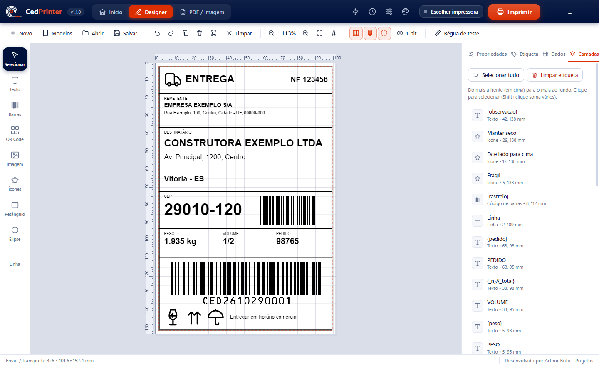
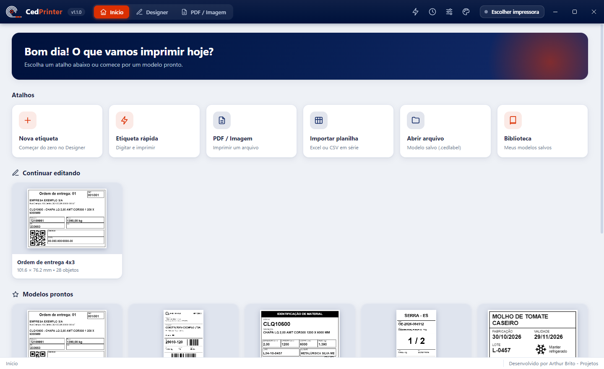
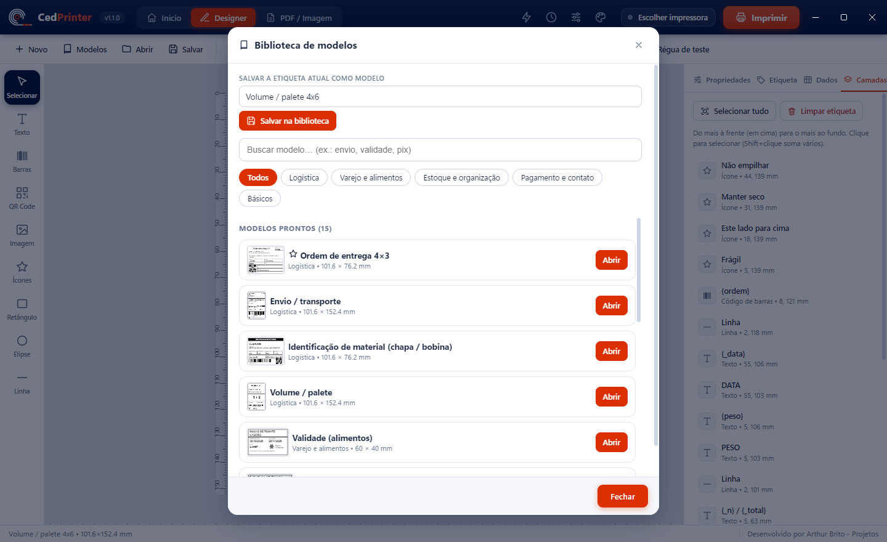
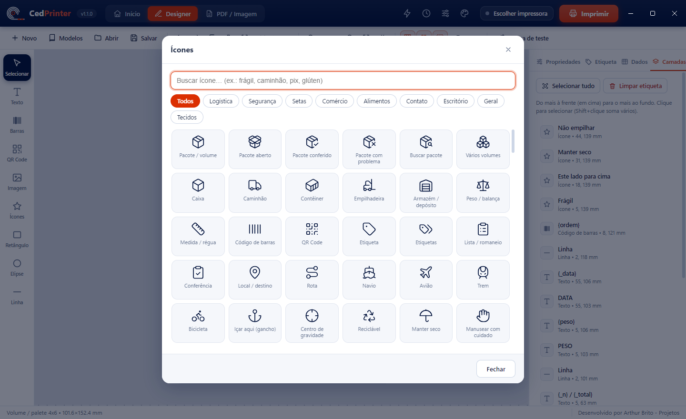
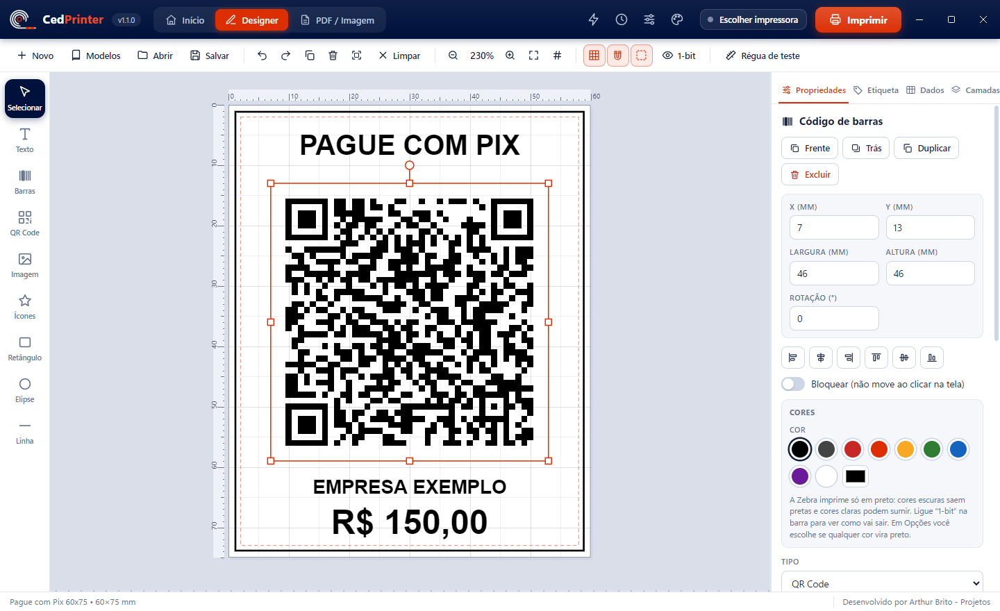
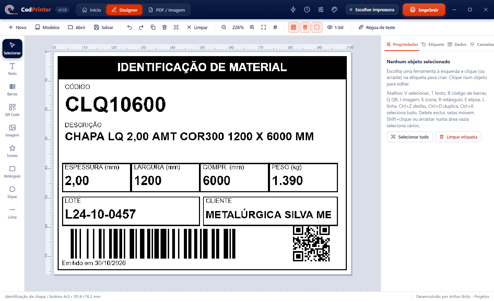
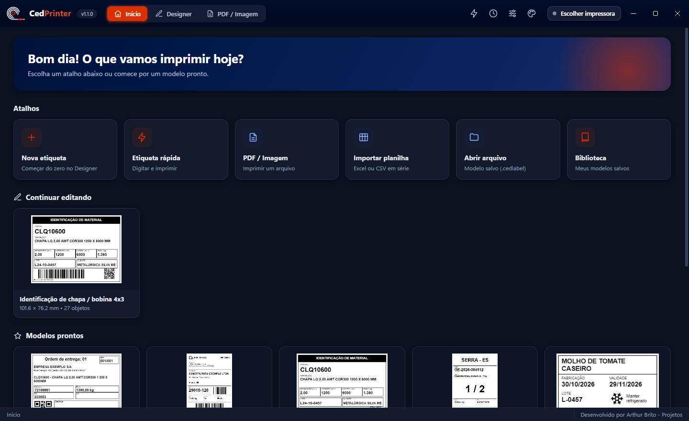

  

<h3 align="center">Crie e imprima etiquetas em impressoras Zebra, sem anúncios.</h3>

  Designer visual · impressão em série · QR Pix · 255 ícones · modelos prontos · Windows e Android

  
  
  
  
  

  <a href="https://github.com/arthurbrito-pjt/CedPrinter-releases/releases/latest"><b>⬇️ Baixar o CedPrinter</b></a>

  

---

## O que é

O **CedPrinter** é um aplicativo para **criar e imprimir etiquetas em impressoras Zebra (ZPL)**, feito para a **Cedisa Central de Aço** e aberto a qualquer pessoa. É gratuito, **sem anúncios** e 100% em português. O código-fonte é privado; aqui ficam os instaladores e as versões publicadas.

Ele monta a etiqueta no **tamanho exato da sua mídia** e envia direto para a impressora, então o tamanho e a posição saem sempre certos.

## Em imagens

<table>
  <tr>
    <td width="50%"> <b>Início:</b> atalhos, modelos prontos e impressões recentes.</td>
    <td width="50%"> <b>Modelos prontos:</b> envio, volume, validade, preço, Pix e mais.</td>
  </tr>
  <tr>
    <td> <b>255 ícones</b> com busca em português.</td>
    <td> <b>QR com assistente:</b> Pix, Wi-Fi, link, WhatsApp e contato.</td>
  </tr>
  <tr>
    <td> <b>Prévia 1-bit:</b> veja como a Zebra vai imprimir.</td>
    <td> <b>Tema claro e escuro</b> e cor de destaque.</td>
  </tr>
</table>

## Destaques

- **Designer visual:** texto, códigos de barras (Code 128, Code 39, EAN-13/8, UPC-A, ITF), QR Code, Data Matrix, PDF417, imagens, ícones, formas e linhas.
- **Edição de verdade:** seleção múltipla, alinhar e distribuir, guias, camadas, copiar/colar, desfazer/refazer.
- **Impressão em série:** importe uma planilha (Excel/CSV) e imprima uma etiqueta por linha, com número de série.
- **Datas calculadas:** `{_data+30}` para validade e vários formatos.
- **QR com assistente:** Pix, Wi-Fi, link, contato, WhatsApp, e-mail, SMS e mapa. **Validação** dos códigos antes de imprimir.
- **PDF e imagem:** imprime em tamanho real ou leva para o Designer para editar.
- **Modelos prontos** e biblioteca própria, histórico e etiqueta rápida.
- **Impressão direta (ZPL):** por rede (IP), USB/Windows, Wi-Fi, Bluetooth e USB (Android).
- **Atualização automática**, mostrando o que mudou.

## Baixar

**➡️ [Abrir a última versão](https://github.com/arthurbrito-pjt/CedPrinter-releases/releases/latest)** e baixar o arquivo da lista **Assets**:

| Arquivo | Para quê |
|---|---|
| `CedPrinter-Setup-X.exe` | **Instalador do Windows** (recomendado). Atualiza sozinho. |
| `CedPrinter-PC-X.zip` | Versão portátil do Windows, sem instalação. Não atualiza sozinha. |
| `CedPrinter-X.apk` | **Aplicativo Android** (celular e coletor). |

> `latest.yml` é um arquivo interno de atualização: não precisa baixar.

## Instalar

### 🖥️ Windows

1. Baixe o `CedPrinter-Setup-X.exe` e abra.
2. Se o Windows avisar "O Windows protegeu o computador", clique em **Mais informações → Executar assim mesmo** (o instalador ainda não tem assinatura de código).
3. Siga o assistente e clique em **Instalar**.
4. No primeiro uso, clique no botão da impressora, no topo da tela, e escolha a sua Zebra.

### 📱 Android

1. Baixe o `CedPrinter-X.apk` no aparelho e abra o arquivo.
2. Se o Android pedir, permita **instalar apps desconhecidos** para o navegador ou gerenciador de arquivos usado.
3. Abra o CedPrinter, vá em **Impressoras** e escolha a Zebra (Wi-Fi, Bluetooth ou USB).

## Perguntas frequentes

**Quais impressoras funcionam?** Impressoras **Zebra com ZPL** (referência: ZD230, 203 dpi), por rede, USB ou Bluetooth. Outras marcas não são compatíveis.

**Preciso de internet?** Só para baixar o app e as atualizações. Imprimir e criar etiquetas funciona offline.

**O app coleta meus dados?** Não. Seus modelos, histórico e configurações ficam no seu computador. O app só consulta aqui no GitHub se há versão nova.

**É gratuito?** Sim, para uso pessoal e comercial. Veja os [termos de uso](LICENSE).

**Achei um problema ou tenho uma ideia.** Abra uma [issue](https://github.com/arthurbrito-pjt/CedPrinter-releases/issues/new/choose) informando a versão e, se possível, a impressora.

## Histórico de versões

As novidades de cada versão estão em [Releases](https://github.com/arthurbrito-pjt/CedPrinter-releases/releases).

---

  Desenvolvido por <b>Arthur Brito - Projetos</b> · Criado para a Cedisa Central de Aço 
  <a href="https://github.com/arthurbrito-pjt">github.com/arthurbrito-pjt</a>

